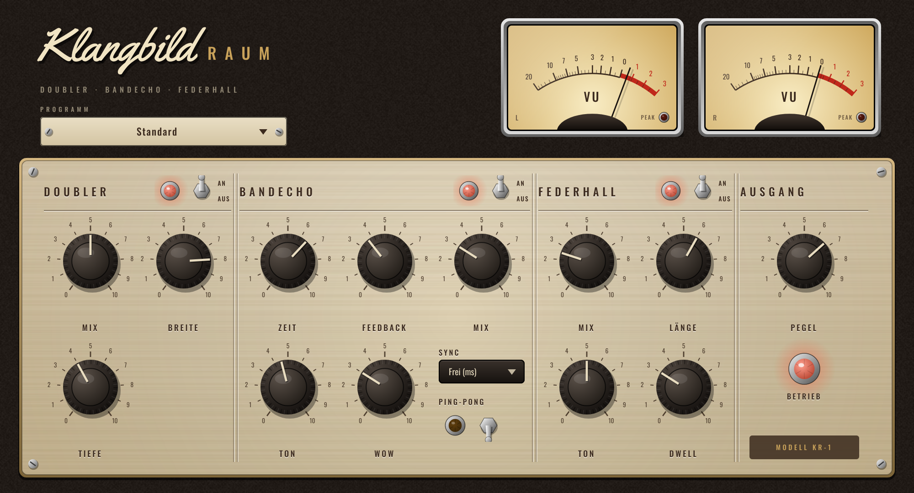

# Klangbild Raum

„Amp im Raum“ für Gitarre: **Doubler, Bandecho und Federhall** in einem Plugin.
Gedacht für die Zeit nach einem NAM-Profil oder einer anderen Amp-Simulation in Logic Pro.
Audio Unit (AU), VST3 und eigenständige App, gebaut mit [JUCE](https://juce.com).



## Signalweg

Mono oder Stereo rein → **Doubler** → **Bandecho** → **Federhall** → **Output** (Stereo)

| Block | Regler | Was passiert |
|---|---|---|
| **Doubler** | Mix, Breite, Tiefe | Zwei leicht verzögerte (10–21 ms), sanft in der Tonhöhe schwankende Kopien links/rechts, wie zwei eingespielte Spuren |
| **Bandecho** | Zeit, Feedback, Mix, Ton, Wow, Sync, Ping-Pong | Wiederholungen werden dunkler, Bandsättigung im Feedback, Gleichlaufschwankungen (Wow & Flutter). Zeitänderungen gleiten wie bei echtem Band. Sync folgt dem Logic-Tempo |
| **Federhall** | Mix, Länge, Ton, Dwell | Drei simulierte Federn mit dem typischen „Zwitschern“ (gestreckte Allpass-Ketten nach Välimäki/Parker). Dwell treibt die Federn stärker an |

Wenn du Bandecho oder Federhall ausschaltest, klingen die Wiederholungen bzw. der Hall natürlich aus.

### Presets
Standard · Slapback Rockabilly · Surf · Breiter Rhythmus · Ambient Lead · Dub Echo · Clean Ballade · Nur Doubler
(in Logic auch über das Preset-Menü oben im Plugin-Fenster erreichbar)

### Tipp für Logic
Auf einer Mono-Gitarrenspur das Plugin als **Mono → Stereo** einsetzen, damit Doubler und Ping-Pong
in Stereo ankommen. Die Mix-Regler von Echo und Hall arbeiten wie bei Pedalen: Das trockene Signal bleibt immer voll erhalten.

## Fertiges Plugin herunterladen

Bei jedem Push baut GitHub das Plugin automatisch (Tab **Actions** → letzter grüner Lauf →
**Artifacts** → `Klangbild-Raum-macOS`).

## Installation in Logic Pro

1. `Klangbild-Raum-AU.zip` entpacken → `Klangbild Raum.component`
2. Finder → ⇧⌘G → `~/Library/Audio/Plug-Ins/Components` → Datei hineinkopieren
3. Einmal im Terminal:
   ```
   xattr -dr com.apple.quarantine ~/Library/Audio/Plug-Ins/Components/"Klangbild Raum.component"
   ```
4. Logic starten: **Audio Units → Klangbild → Klangbild Raum**
   (falls nicht sichtbar: Einstellungen → Plug-in-Manager → *Zurücksetzen & erneut scannen*)

## Selbst bauen (Xcode)

```bash
cmake -B build -G Xcode -DCMAKE_OSX_ARCHITECTURES="arm64;x86_64"
cmake --build build --config Release
```

## Projektaufbau

| Datei | Inhalt |
|---|---|
| `Source/RaumDsp.h` | Doubler, Bandecho, Federhall (reines C++) |
| `Source/PluginProcessor.*` | Parameter, Presets, Signalweg |
| `Source/PluginEditor.*` | Vintage-Oberfläche mit VU-Metern (0 VU = −18 dBFS) |
| `Resources/` | Schriften für die Oberfläche |
| `.github/workflows/build-macos.yml` | Automatischer Mac-Build inkl. `auval`-Test |

## Lizenz-Hinweis

Schriften: *Oswald* (SIL Open Font License 1.1) und *Yellowtail* (Apache License 2.0), Lizenztexte in `Resources/`.

JUCE steht unter AGPLv3 bzw. einer kommerziellen Lizenz. Für den privaten Gebrauch unproblematisch.
